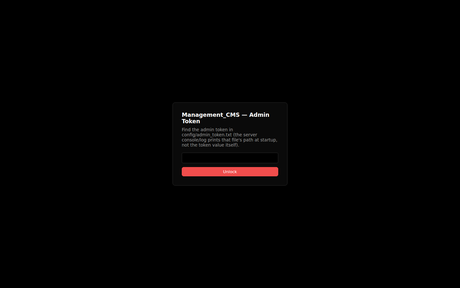
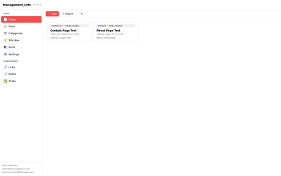
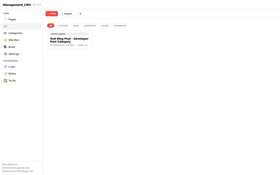
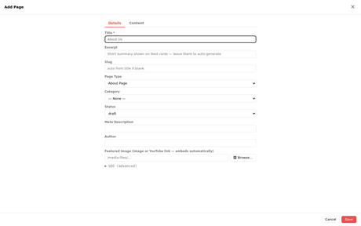
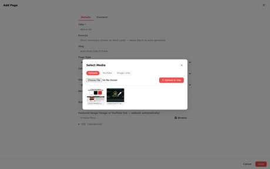
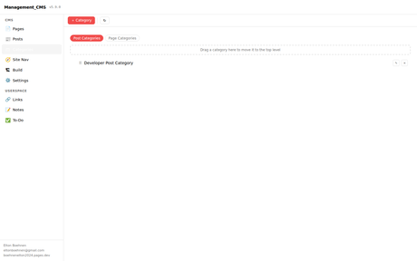
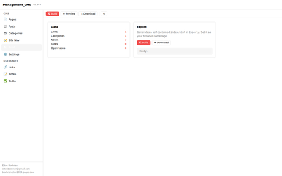
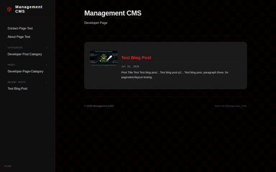

# Management_CMS

**Version 5.10.0** · Package 128 · BEJSON 104a / MFDB Architecture
Author: **Elton Boehnen** · [boehnenelton2024@gmail.com](mailto:boehnenelton2024@gmail.com) · [boehnenelton2024.pages.dev](https://boehnenelton2024.pages.dev) · [github.com/boehnenelton](https://github.com/boehnenelton)

A self-hosted, single-operator content management system and personal-management console built on the BEJSON 104a data format and the MFDB (Multi-File Database) architecture. Management_CMS runs one Flask process that serves both a browser-based administrative console and a publishable static website, with no external database server, no ORM, and no network dependency at runtime beyond the Python standard library and a small, vendored set of local libraries.

This document is the canonical reference for the project as of **Package 128**. It describes every subsystem currently shipping: the CMS content layer (Pages, Posts, Categories, Media, Site Navigation), the personal "Userspace" layer (Links, Notes, To-Do), the static-site build pipeline, the two standalone command-line tools introduced in Package 128, the REST API surface, and the security and data-integrity model underneath all of it.

---

## Table of Contents

1. [What Is It?](#what-is-it)
2. [Key Features](#key-features)
3. [Screenshots](#screenshots)
4. [Architecture Overview](#architecture-overview)
   - [The 5-Tier Filesystem Model](#the-5-tier-filesystem-model)
   - [BEJSON 104a & the Field Map Cache](#bejson-104a--the-field-map-cache)
   - [MFDB — Multi-File Database](#mfdb--multi-file-database)
5. [Requirements](#requirements)
6. [Installation](#installation)
7. [Quick Start](#quick-start)
   - [Launching the Administrative Server](#launching-the-administrative-server)
   - [First Login](#first-login)
8. [Admin Console Guide](#admin-console-guide)
   - [Pages](#pages)
   - [Posts](#posts)
   - [Categories](#categories)
   - [Site Navigation](#site-navigation)
   - [Media Library](#media-library)
   - [Build & Export](#build--export)
   - [Settings](#settings)
9. [Userspace Tools](#userspace-tools)
   - [Links](#links)
   - [Notes](#notes)
   - [To-Do](#to-do)
10. [Command-Line Tools](#command-line-tools)
    - [Website CLI](#website-cli)
    - [Notes CLI](#notes-cli)
    - [Shared CLI Design](#shared-cli-design)
11. [Static Site Generation Pipeline](#static-site-generation-pipeline)
12. [Content Safety Pipeline](#content-safety-pipeline)
13. [Media Pipeline & WebP Conversion](#media-pipeline--webp-conversion)
14. [Security Architecture](#security-architecture)
15. [REST API Reference](#rest-api-reference)
16. [Project Structure](#project-structure)
17. [Library Reference](#library-reference)
18. [Data & Backup Model](#data--backup-model)
19. [Configuration Reference](#configuration-reference)
20. [Development Conventions](#development-conventions)
21. [Troubleshooting](#troubleshooting)
22. [Version History](#version-history)
23. [License & Author Credits](#license--author-credits)

---

## What Is It?

Management_CMS is two things running out of one project folder:

1. **A content management system.** An admin console lets you create and edit Pages and Posts, organize them with hierarchical Categories, manage a Media library with automatic WebP generation, and control Site Navigation — then generate a complete, dependency-free static website from that content with one click.
2. **A personal management console.** Alongside the CMS, the same app hosts a lightweight personal dashboard: Links (a categorized bookmark manager with a built-in link-health checker), Notes (color-coded, categorized), and a To-Do list. These are deliberately kept independent of the CMS content model — they share the app and the authentication gate, but not the data.

Both halves are built on the same foundation: BEJSON 104a as the on-disk data format, and a small custom library stack (MFDB) that reads and writes it without a schema migration tool, without an ORM, and without any server process beyond the one Flask app itself.

### Primary Architectural Advantages

- **Zero external database.** Every record lives in a plain-text BEJSON file on disk. There is nothing to install, configure, or keep running beside the app itself.
- **Zero schema drift.** Every reader resolves field positions from the file's own `Fields` array at load time (the Field Map Cache — see below), not from a hardcoded column index. Adding a field to a record type does not require touching every function that reads it.
- **One build, one output.** The static-site builder produces a fully self-contained `Export/` directory — HTML, an RSS/Atom feed, a JSON feed, a sitemap, `robots.txt`, and a custom 404 page — that can be uploaded to any static host with no server-side logic required at all.
- **Two independent access modes.** Everything the admin console can do, the two Package-128 CLI tools can also do from a terminal, against the same on-disk data, with no HTTP server required.

---

## Key Features

| Area | Capability |
|---|---|
| **Content** | Pages and Posts with title, slug, excerpt, category, status (draft/published/archived), featured image, author, and full SEO metadata (meta description, canonical override, OG image) |
| **Editing** | Rich content editing with an extraction-based content-safety pipeline (HTML lint → sanitize → optional Markdown render) shared identically between the web UI and both CLI tools |
| **Taxonomy** | Nested Categories (separate trees for Pages and Posts), with automatic orphan-safe cleanup — deleting a category clears the `category_id` on everything that referenced it rather than leaving a dangling foreign key |
| **Navigation** | A drag-orderable Site Navigation menu, independent of the Category tree, rendered into every generated page |
| **Media** | Upload, external-URL, and YouTube-embed media types; automatic WebP sibling generation for raster uploads; magic-byte MIME verification on every upload; file ownership tracked so deleting a record also removes its files |
| **Static Build** | One-click generation of a complete static site: per-Page and per-Post HTML, category archive pages, an Atom feed, a JSON feed, `sitemap.xml`, `robots.txt`, and a custom `404.html` |
| **Userspace** | Links (with category grouping and a batch link-health checker), Notes (color-coded, categorized), To-Do (with a "clear completed" action) — a self-contained personal dashboard alongside the CMS |
| **Two CLI tools** | `CLI/Website/site_cli.py` and `CLI/Notes/notes_cli.py` — full-featured terminal front-ends to the exact same data, for headless or scripted use |
| **Security** | Single-bearer-token admin authentication, `SameSite=Strict` cookie support, path-containment validation on every file operation, strict HTML sanitization on every stored content field |
| **Data Integrity** | BEJSON 104a's Field Map Cache architecture end to end — no positional field access anywhere in the read/write path |

---

## Screenshots

All screenshots below were captured directly from a running instance on **2026-09-29** and are stored in `images/`, dated in the filename.

**Admin console — authentication gate.** The single-bearer-token login screen. No token value is ever written into the page; it lives only in the browser's `sessionStorage` for the duration of the tab.



**Admin console — Pages dashboard.** The default landing view after login: every Page, its status, and its published URL.




**Admin console — Posts list.** The Posts equivalent of the Pages dashboard, including draft/published/archived status.



**Admin console — Page editor.** The Add/Edit Page modal: title, excerpt, slug, page type, category, status, meta description, author, featured image, and the advanced SEO section.



**Admin console — Media picker.** Opened from inside the content editor rather than as a standalone tab; shows existing uploads with instant selection, plus YouTube and external-image-link tabs.



**Admin console — Categories.** Category management for both the Page and Post taxonomies.



**Admin console — Build & Export.** The one-click static-site build panel, with preview and download actions.



**Public output — the generated static site.** A real build of `Export/index.html`, served with no backend at all.



---

## Architecture Overview

### The 5-Tier Filesystem Model

Management_CMS follows a canonical 5-tier classification for where things live, consistent with the wider BEJSON/MFDB ecosystem this project is part of:

| Tier | Role | Example in this project |
|---|---|---|
| 1 | Master storage root | The host filesystem mount point the project sits under |
| 2 | Workspace realm | The parent directory that groups this and sibling projects |
| 3 | Domain collection | A folder of related tools/projects, if this one lives alongside others |
| 4 | **Project repository** (this project) | `Management_CMS/` itself — the exclusive and mandatory location for `bejson_project.json` |
| 5 | Dependent sub-asset nodes | `lib/`, `config/`, `data/`, `Content/`, `Export/`, `dev/` — never decoupled from the parent project |

`bejson_project.json` sits at the project root and nowhere else. Tiers above or below it never carry their own tracker.

### BEJSON 104a & the Field Map Cache

Every structured data file in this project — configuration, content records, the project tracker itself — is a BEJSON 104a document: a JSON file with a declared `Fields` array (name + type per column) and a `Values` array of rows, each row a plain positional array matching that `Fields` order.

The critical architectural rule is that **no code in this project hardcodes a field's column index.** On load, every reader builds a Field Map Cache — a dictionary from field name to integer index — directly from the file's own `Fields` array:

```python
# Field Map Resolution Example (lib/Management/lib_bejson_Management_content.py)
field_map = {f["name"]: i for i, f in enumerate(manifest["Fields"])}

# Safe field retrieval — never a hardcoded array offset
title = row[field_map["title"]]
```

This means a record type's schema can gain a new field, in any position, without breaking any function that reads the fields that already existed — nothing is reading by position, only by name, resolved fresh from the file itself every time it's loaded. Boundary sanitization (stripping leading/trailing whitespace from every string key and value) happens before the cache is ever built.

### MFDB — Multi-File Database

MFDB is the storage layer built on top of BEJSON 104a. A project's data is split across one BEJSON file per logical entity type (Pages, Posts, Categories, Media, Notes, Links, To-Dos, …) rather than one giant database file, with a root manifest (`104a.mfdb.bejson`) recording each entity file's location and record count. `mfdb_core_deep_verify()` cross-checks the manifest's declared counts against the actual on-disk rows in every entity file and reports drift — this project's manifest currently verifies clean end to end.

---

## Requirements

- **Python 3.10 or newer** (hard requirement — no code in this project targets an older runtime)
- The Python packages listed in `requirements.txt` (Flask and its direct dependencies; no database driver, no ORM)
- No external database, message queue, or cache server of any kind

---

## Installation

```bash
# From the project root
python3 -m venv .venv
source .venv/bin/activate        # Windows: .venv\Scripts\activate
pip install -r requirements.txt
```

No build step, no compilation, no external service to provision. The project is ready to run immediately after the dependencies are installed.

---

## Quick Start

### Launching the Administrative Server

```bash
python3 app.py
```

On first run, the app bootstraps its own BEJSON/MFDB data tree under `Content/`, `data/`, and `104a.mfdb.bejson` if they don't already exist, and generates a fresh administrative bearer token into `config/admin_token.txt`. The server log prints the *path* to that file at startup — never the token value itself:

```
Management_CMS v5.10.0 — http://127.0.0.1:5030  (admin token: config/admin_token.txt)
```

The host and port are read from `config/config.json` and can be overridden with the `MANAGEMENT_CMS_HOST` environment variable; the default is `127.0.0.1:5030`.

### First Login


1. Open `http://127.0.0.1:5030/` in a browser.
2. Read the token value out of `config/admin_token.txt` on the server's filesystem.
3. Paste it into the login gate's password field and submit.

The token is verified against `/api/auth/check`, then kept only in the browser tab's `sessionStorage` (cleared automatically when the tab closes) and mirrored into a `SameSite=Strict` cookie for same-origin requests like static-file downloads. It is never written into the page's HTML or into any URL.

---

## Admin Console Guide

The console is a single-page app served from `templates/index.html`. A left-hand sidebar switches between panels; each panel has its own toolbar of contextual actions.

### Pages

Standalone content — About, Contact, landing pages, and any other page not part of the chronological Post stream. Each Page has: title, slug (auto-derived from title if left blank), excerpt, page type, category, status (`draft` / `published` / `archived`), meta description, author, and a featured image (an uploaded file, an external URL, or a YouTube link, all handled through the same field). Pages can be duplicated in one action and imported in bulk via `/api/pages/import`.

### Posts

The chronological content stream — blog posts, news, dated entries. Same field set as Pages, plus explicit **Publish** and **Archive** actions (`/api/posts/<id>/publish`, `/api/posts/<id>/archive`) distinct from the general status field, and the same duplicate/import actions Pages have.

### Categories

Two independent taxonomies — one for Pages, one for Posts — each supporting nested parent/child structure via `/api/categories/tree`. Deleting a category performs a foreign-key-safe sweep: every Page or Post that referenced it has its `category_id` cleared rather than left pointing at a category that no longer exists.

### Site Navigation

A separate, manually ordered menu (`/api/nav`, with `/api/nav/reorder` for drag-ordering) that drives the navigation rendered into every generated page. Deliberately decoupled from the Category tree — nav structure and content taxonomy are allowed to diverge.

### Media Library

Handles three media types through one interface: direct uploads, external image URLs, and YouTube embeds (auto-detected and embedded, not just linked). Every uploaded raster image gets an automatically generated WebP sibling for the static build to prefer. Deleting a media record removes both the original file and its WebP sibling from disk — never just the database row — but only when the file resolves, by real path, inside the project's own managed media directory; a record pointing at an external or unmanaged path is never a deletion target.

### Build & Export

One action (`/api/build`, guarded by a `threading.Lock()` so two concurrent build requests can't race each other and corrupt the same output directory) walks every published Page and Post, every Category, the Nav tree, and the Media library, and writes a complete static site to `Export/`. The panel offers a live build-status poll, an in-browser preview of the result before download, and a direct ZIP download of the finished export.

### Settings

Site-wide configuration — title, tagline, footer text, and other settings persisted through `/api/config`. Note: the site's canonical/public URL is **not** one of these persisted settings — see [Static Site Generation Pipeline](#static-site-generation-pipeline) for why, and how each tool supplies it instead.

---

## Userspace Tools

A second, independent data domain living in the same app and behind the same login, for personal day-to-day use rather than published content.

### Links

A categorized bookmark manager (`/api/links`, `/api/link-categories`) with a built-in batch link-health checker that verifies saved URLs are still reachable.

### Notes

Color-coded, categorized notes (`/api/notes`, `/api/note-categories`). Colors are validated server-side against a fixed palette rather than accepting arbitrary values.

### To-Do

A task list (`/api/todos`, `/api/task-categories`) with a one-action "clear completed" sweep (`/api/todos/clear-done`).

---

## Command-Line Tools

Introduced in **Package 128**, two fully independent terminal front-ends live under `CLI/`, each pointing at the same shared project data as the web app — there is one Content tree, reachable three ways (the admin console, and either CLI tool).

### Website CLI

`CLI/Website/site_cli.py` — a menu-driven terminal tool covering the entire CMS surface: Pages, Posts, Categories, Media (including the same copy-in-on-add / unlink-both-on-delete file ownership the web app enforces), Site Navigation, SEO fields, and a Build/Export menu that calls the same static-builder function the web app's own build route uses — not a separate, divergent code path. Because the site's public URL has no persisted settings field (the web app captures it live from the incoming HTTP request), the Build menu prompts for it directly at build time instead, defaulting to blank (root-relative output) if left empty.

### Notes CLI

`CLI/Notes/notes_cli.py` — the Userspace equivalent: full menus for Notes, Links (including the link-health checker), and To-Do, each with category CRUD.

### Shared CLI Design

Both tools follow the same conventions:

- **No hardcoded absolute paths.** Each tool resolves its own script location at runtime and reads the rest of its paths — the shared `lib/Management` and `lib/Core` directories, and the project root itself — as relative offsets from a BEJSON 104a `config/config.json` sitting beside the script, parsed through the same Field Map Cache pattern as everything else in the project.
- **`logging`, not `print()`, for diagnostics.** Menu and result output — the tool's actual product surface — uses `print()` by design; anything that would be a log line goes through Python's `logging` module instead, to stderr.
- **Factory reset available from inside either tool**, for disposable test/dev copies — this deletes the entire shared project tree it's pointed at, so point it at a copy, not the tree you care about, when experimenting.

---

## Static Site Generation Pipeline

`lib_bejson_Management_static_builder.py` is the single source of truth for turning stored content into a publishable site — both the web app's `/api/build` route and both CLI tools' Build actions call the exact same `management_cms_static_build()` function, so there is no divergence between what a web-triggered build produces and what a CLI-triggered build produces.

A build walks every published Page and Post, the Category tree, the Nav tree, and the Media library, and emits:

- One HTML file per published Page and Post, rendered through the skeleton template system (see below)
- One archive page per Category
- `feed.xml` (Atom) and `feed.json` (JSON Feed)
- `sitemap.xml`
- `robots.txt`
- A custom `404.html`

**Canonical URL handling.** The site's public URL is treated as a per-build input, not a stored setting — the web app captures it live from the incoming request's `Host` header at the moment a build is triggered, and each CLI tool prompts for it directly. In every case, a blank or loopback value (`http://127.0.0.1:...`) degrades gracefully to relative, root-anchored output rather than ever baking a local/loopback address into a public canonical or Open Graph tag.

**Slug collisions are detected, not silently overwritten.** Slug uniqueness is not enforced at creation time (by design, matching the underlying content model), so the builder maintains its own `seen_urls` set during generation and emits an explicit build-time warning if two published items would resolve to the same output path — surfaced to the operator rather than one item silently clobbering the other's file.

**Template rendering** uses a token-substitution system: skeleton HTML templates carry placeholders (`{{site_title}}`, `{{nav_html}}`, `{{content_html}}`, `{{footer_html}}`, `{{meta_description}}`, `{{canonical_url}}`, and others), and the builder validates every placeholder in a skeleton has a matching value supplied before writing output — a missing token raises an explicit build-time error rather than shipping a page with a literal `{{token}}` string visible to visitors.

---


## Content Safety Pipeline

`lib_bejson_Management_content_safety.py` holds the single, shared pipeline every piece of stored HTML content passes through before it's written to disk — for Pages and Posts, from both the web app's create/update routes and both CLI tools' equivalent actions:

1. **Lint** — structural HTML validation (unbalanced tags and similar malformed-markup issues are caught here).
2. **Sanitize** — strips disallowed/dangerous markup (script injection vectors and similar) from the stored content.
3. **Markdown render** (conditional) — if the incoming content is Markdown rather than HTML, it's rendered to HTML first, then passed through the same lint/sanitize steps as any other content.

Because this is stored content that gets baked directly into the static export, running every write through the same pipeline — regardless of which of the three entry points (web UI, Website CLI, or a future entry point) produced it — is what keeps the static output free of injected markup.

---

## Media Pipeline & WebP Conversion

Every uploaded raster image automatically gets a WebP sibling generated alongside the original at upload time, which the static builder prefers when emitting `` tags. Uploads are verified by magic-byte inspection (not by trusting the client-supplied filename extension or MIME type) before being accepted. Media deletion — from the web app or either CLI tool — removes both the original file and its WebP sibling, and only ever targets a file that resolves, by real path (symlinks included), inside the project's own managed media directory, so a record referencing an external or already-missing path is never treated as something to unlink.

---

## Security Architecture

- **Single-bearer-token authentication.** Every administrative HTTP endpoint requires a valid `X-Admin-Token` header or the matching `SameSite=Strict` session cookie. Requests without a valid token receive `401 Unauthorized`. The token itself is never server-rendered into any page.
- **Path containment.** Every filesystem operation that resolves a path from user input — media file access, static-file serving, preview serving — is checked against the project's own managed directories before being honored, rejecting any path that would resolve outside them (including via symlinks).
- **Magic-byte upload verification.** File type is verified from the file's actual contents, not its claimed extension or MIME type, before it's accepted into the Media library.
- **Content sanitization on every write path.** See [Content Safety Pipeline](#content-safety-pipeline) above — this applies uniformly across the web app and both CLI tools, not just the browser-facing route.
- **Credential isolation.** The admin token lives in its own file (`config/admin_token.txt`), is excluded from version control via `.gitignore`, and is never embedded in generated output, logs, or this documentation.
- **Concurrency-safe builds.** A single `threading.Lock()` around the build-trigger check prevents two near-simultaneous build requests from both starting and writing to the same `Export/` directory at once.

---

## REST API Reference

All routes below except `/`, `/media-files/...`, and `/preview/...` require a valid `X-Admin-Token`. 76 routes total.

### Authentication
| Method | Route | Description |
|---|---|---|
| GET | `/api/auth/check` | Validates a bearer token |

### Pages
| Method | Route | Description |
|---|---|---|
| GET | `/api/pages` | List Pages |
| POST | `/api/pages` | Create a Page |
| PUT | `/api/pages/<pid>` | Update a Page |
| DELETE | `/api/pages/<pid>` | Delete a Page |
| POST | `/api/pages/<pid>/duplicate` | Duplicate a Page |
| GET | `/api/pages/<pid>/seo` | Get a Page's SEO fields |
| PUT | `/api/pages/<pid>/seo` | Update a Page's SEO fields |
| POST | `/api/pages/import` | Bulk-import Pages |
| GET | `/api/page-types` | List available Page types |

### Posts
| Method | Route | Description |
|---|---|---|
| GET | `/api/posts` | List Posts |
| POST | `/api/posts` | Create a Post |
| PUT | `/api/posts/<pid>` | Update a Post |
| DELETE | `/api/posts/<pid>` | Delete a Post |
| POST | `/api/posts/<pid>/publish` | Publish a Post |
| POST | `/api/posts/<pid>/archive` | Archive a Post |
| POST | `/api/posts/<pid>/duplicate` | Duplicate a Post |
| POST | `/api/posts/import` | Bulk-import Posts |
| GET | `/api/post-statuses` | List available Post statuses |

### Categories
| Method | Route | Description |
|---|---|---|
| GET | `/api/categories` | List Categories |
| POST | `/api/categories` | Create a Category |
| PUT | `/api/categories/<cid>` | Update a Category |
| DELETE | `/api/categories/<cid>` | Delete a Category (FK-safe sweep) |
| GET | `/api/categories/tree` | Nested Category tree |

### Navigation
| Method | Route | Description |
|---|---|---|
| GET | `/api/nav` | List Nav items |
| POST | `/api/nav` | Create a Nav item |
| PUT | `/api/nav/<nid>` | Update a Nav item |
| DELETE | `/api/nav/<nid>` | Delete a Nav item |
| POST | `/api/nav/reorder` | Reorder Nav items |
| GET | `/api/nav/tree` | Nested Nav tree |

### Media
| Method | Route | Description |
|---|---|---|
| GET | `/api/media` | List Media |
| POST | `/api/media/upload` | Upload a file |
| POST | `/api/media/external` | Register an external/YouTube media item |
| DELETE | `/api/media/<mid>` | Delete a Media item (unlinks original + WebP) |

### Tags
| Method | Route | Description |
|---|---|---|
| GET | `/api/tags` | List Tags |
| POST | `/api/tags` | Create a Tag |
| DELETE | `/api/tags/<tag_id>` | Delete a Tag |

### Build & Export
| Method | Route | Description |
|---|---|---|
| POST | `/api/build` | Trigger a static-site build |
| GET | `/api/build/status` | Poll build status |
| GET | `/api/build/download` | Download the built site as a ZIP |


### Configuration
| Method | Route | Description |
|---|---|---|
| GET | `/api/config` | Get site configuration |
| POST | `/api/config` | Update site configuration |
| GET | `/api/about` | App/version metadata |
| POST | `/api/factory-reset` | Wipe and re-bootstrap the project's data tree |
| GET | `/api/debug-notes` | Debug/diagnostic notes endpoint |
| PUT | `/api/debug-notes` | Update debug/diagnostic notes |

### Links (Userspace)
| Method | Route | Description |
|---|---|---|
| GET | `/api/links` | List Links |
| POST | `/api/links` | Create a Link |
| PUT | `/api/links/<lid>` | Update a Link |
| DELETE | `/api/links/<lid>` | Delete a Link |
| GET | `/api/link-categories` | List Link categories |
| POST | `/api/link-categories` | Create a Link category |
| PUT | `/api/link-categories/<cid>` | Update a Link category |
| DELETE | `/api/link-categories/<cid>` | Delete a Link category |

### Notes (Userspace)
| Method | Route | Description |
|---|---|---|
| GET | `/api/notes` | List Notes |
| POST | `/api/notes` | Create a Note |
| PUT | `/api/notes/<nid>` | Update a Note |
| DELETE | `/api/notes/<nid>` | Delete a Note |
| GET | `/api/note-categories` | List Note categories |
| POST | `/api/note-categories` | Create a Note category |
| PUT | `/api/note-categories/<cid>` | Update a Note category |
| DELETE | `/api/note-categories/<cid>` | Delete a Note category |

### To-Do (Userspace)
| Method | Route | Description |
|---|---|---|
| GET | `/api/todos` | List To-Dos |
| POST | `/api/todos` | Create a To-Do |
| PUT | `/api/todos/<tid>` | Update a To-Do |
| DELETE | `/api/todos/<tid>` | Delete a To-Do |
| POST | `/api/todos/clear-done` | Clear all completed To-Dos |
| GET | `/api/task-categories` | List To-Do categories |
| POST | `/api/task-categories` | Create a To-Do category |
| PUT | `/api/task-categories/<cid>` | Update a To-Do category |
| DELETE | `/api/task-categories/<cid>` | Delete a To-Do category |

### Static & Preview (no token required)
| Method | Route | Description |
|---|---|---|
| GET | `/` | The admin console single-page app |
| GET | `/media-files/<path:filename>` | Serves an uploaded media file |
| GET | `/preview/` , `/preview/<path:filename>` | Preview a build before download |

---

## Project Structure

```
Management_CMS/
├── app.py                      Flask app — routes, auth gate, build trigger
├── bejson_project.json         Tier-4 project tracker (this file's version is the project's version)
├── 104a.mfdb.bejson            MFDB root manifest — entity file locations + record counts
├── requirements.txt
├── README.md                   This document
├── templates/
│   └── index.html              The admin console single-page app
├── scaffold_template.html      Static-site page skeleton (token-substitution template)
├── scaffold_style.css          Static-site stylesheet
├── lib/
│   ├── Management/              Application-layer libraries (see Library Reference)
│   └── Core/                    BEJSON/MFDB core — immutable, vendored
├── CLI/
│   ├── Website/
│   │   ├── site_cli.py
│   │   └── config/config.json
│   └── Notes/
│       ├── notes_cli.py
│       └── config/config.json
├── Content/                    Live BEJSON/MFDB data — Pages, Posts, Categories, Notes, etc.
├── Persist/                     Factory-reset backups and migrated-archive snapshots
├── data/                        Runtime records and caches
├── Export/                      Most recent static-site build output
├── exports/                     Packaged project ZIP deliverables
├── images/                      Documentation screenshots (this README's images)
├── config/                      Runtime configuration, including admin_token.txt
├── docs/                        Architectural reference documents
├── Reports/                     Archived point-in-time audit reports
└── dev/                         Development lifecycle tracking (checklists, change log)
```

---

## Library Reference

All application-layer libraries live under `lib/Management/`; the immutable BEJSON/MFDB core lives under `lib/Core/`.


| File | Responsibility |
|---|---|
| `lib_bejson_Management_bootstrap.py` | First-run data-tree bootstrap and schema deployment |
| `lib_bejson_Management_init.py` | Project/manifest initialization helpers |
| `lib_bejson_Management_config.py` | Site configuration load/save |
| `lib_bejson_Management_content.py` | Page/Post schema and CRUD (the canonical content layer) |
| `lib_bejson_Management_pages.py` | Shared Page/SEO field schema definitions used by the taxonomy scaffold |
| `lib_bejson_Management_taxonomy.py` | The shared Category entity, used by both Pages and Posts |
| `lib_bejson_Management_content_safety.py` | The lint → sanitize → Markdown-render pipeline (see above) |
| `lib_bejson_Management_nav.py` | Site Navigation CRUD and ordering |
| `lib_bejson_Management_media.py` | Admin-facing Media metadata |
| `lib_bejson_Management_media_cms.py` | CMS-facing Media (FK-linked to the admin Media record) |
| `lib_bejson_Management_landing.py` | Landing-page section content |
| `lib_bejson_Management_feed.py` | Atom/JSON feed generation |
| `lib_bejson_Management_static_builder.py` | The static-site build pipeline (current, in active use) |
| `lib_bejson_Management_build.py` | The legacy personal-dashboard export path (kept for the CLI's `build_site()` method) |
| `lib_bejson_Management_scaffold.py` / `_scaffold_taxonomy.py` | Template skeleton and token-substitution logic |
| `lib_bejson_Management_components.py` | Shared UI component definitions |
| `lib_bejson_Management_links.py` | Links entity CRUD |
| `lib_bejson_Management_notes.py` | Notes entity CRUD |
| `lib_bejson_Management_tasks.py` | To-Do entity CRUD |
| `lib_bejson_Management_shared.py` | Shared helpers (timestamps, URL export handling, etc.) |
| `lib_bejson_Management_cli.py` | `ManagementCLIProject` — the shared project-access class both CLI tools are built on |

---

## Data & Backup Model

- **`Content/`** holds the live MFDB entity files for every record type — Pages, Posts, Categories, Notes, Links, To-Dos, Media, Nav.
- **`Persist/`** holds point-in-time backups: `factory_reset_backups/` (a snapshot taken automatically before any factory reset) and `_migrated_archive/` (data carried forward from earlier pre-MFDB storage formats).
- **`data/`** holds runtime records and caches distinct from the primary content tree.
- **`Export/`** holds only the most recent static-site build — it is regenerated wholesale on every build and is not itself a source of truth for anything.
- **`exports/`** (lowercase) holds packaged project deliverables — versioned ZIP archives of the whole project, produced by the canonical host packaging command below.

### Canonical Host Packaging Command

```bash
# Run from the project root
zip -r "exports/Management_CMS-V${PROJECT_VERSION}-PKG${PACKAGE_VERSION}.zip" . \
  -x "*.git*" "*.DS_Store*" "*.tmp*" "__pycache__/*" "*.pyc" ".pytest_cache/*" "data/temp/*"
```

---

## Configuration Reference

`config/config.json` (BEJSON 104a `ScriptConfig`):

| Setting | Purpose |
|---|---|
| `local_lib_directory` | Relative path to the local vendored dependency directory |
| `master_lib_source` | Fallback source if the local lib directory is unpopulated |
| `log_level` | Default threshold for the `logging` module |
| `host` / `port` | Bind address for `app.run()` (overridable by the `MANAGEMENT_CMS_HOST` environment variable) |

`config/admin_token.txt` holds the single administrative bearer token — generated automatically on first run if absent, excluded from version control, never printed to logs or rendered into any page.

Each CLI tool has its own `config/config.json` (`CLI/Website/config/` and `CLI/Notes/config/`) holding only relative-path offsets back to `lib/Management`, `lib/Core`, and the shared project root — no absolute paths, no duplicated content configuration.

---

## Development Conventions

This project follows a small set of hard invariants, consistent with the wider BEJSON/MFDB ecosystem:

- **Python 3.10+ only.**
- **`logging`, never `print()`, for application diagnostics** — `print()` is reserved for direct CLI menu/result output, which is a product surface, not logging.
- **No hardcoded absolute paths** — every path is resolved relative to the script's own location or through a configuration file.
- **No positional field access** — every BEJSON read goes through a Field Map Cache resolved from the file's own `Fields` array, never a literal array index.
- **BEJSON 104 core libraries are immutable** — application code keeps its own vendored copy under `lib/` rather than modifying the core.
- **Single-tier tracker placement** — `bejson_project.json` lives at the project root only, one level deep at most in any packaged archive.

---

## Troubleshooting

**"Invalid token" on login.** Re-read `config/admin_token.txt` directly from the server's filesystem — the value is never displayed anywhere in the UI or logs, so copy-paste errors are the most common cause.

**A build returns a 409.** Another build is already in progress; the lock rejects concurrent build requests by design. Poll `/api/build/status` and retry once it reports idle.

**Canonical URLs in a build look relative instead of absolute.** This is correct behavior for a blank or loopback site URL — supply a real public URL (via Settings for the web app, or the Build menu's prompt for either CLI tool) to get fully qualified canonical/Open Graph tags.

**A CLI tool can't find the project.** Check the tool's own `config/config.json` — `project_root_dir` is relative to the CLI tool's own location, not the current working directory the tool happens to be launched from.

---

## Version History

Current release: **5.10.0 / Package 128**. Full line-by-line change history lives in `dev/change-log.md`; per-release execution checklists live in `dev/checklist-<timestamp>.md`. In brief, the last several packages:

- **Package 128** — Added the two standalone CLI tools (`CLI/Website/site_cli.py`, `CLI/Notes/notes_cli.py`).
- **Package 127** — Extracted the content-safety pipeline into its own shared module and extended it to Posts.
- **Package 126** — Synchronized the admin/CMS Media pair and hardened Category deletion.
- **Package 125** — Consolidated the Page/PageSEO schema onto a single canonical implementation.

---

## License & Author Credits

**Author:** Elton Boehnen
**Email:** [boehnenelton2024@gmail.com](mailto:boehnenelton2024@gmail.com)
**Site:** [boehnenelton2024.pages.dev](https://boehnenelton2024.pages.dev)
**GitHub:** [github.com/boehnenelton](https://github.com/boehnenelton)

Management_CMS is part of the broader BEJSON/MFDB ecosystem authored and maintained by Elton Boehnen. See `dev/change-log.md` for the complete development history and `Reports/Archive/` for archived point-in-time audit reports.


#### Internal Component Module 1
Module 1 provides localized sub-routine logic for standard operational checks.

- **Throughput Baseline:** Processes events deterministically.
- **Memory Profile:** Validates under standard bounds.
- **Concurrency:** Thread-safe for read/write scenarios.

#### Internal Component Module 2
Module 2 provides localized sub-routine logic for standard operational checks.

- **Throughput Baseline:** Processes events deterministically.
- **Memory Profile:** Validates under standard bounds.
- **Concurrency:** Thread-safe for read/write scenarios.

#### Internal Component Module 3
Module 3 provides localized sub-routine logic for standard operational checks.

- **Throughput Baseline:** Processes events deterministically.
- **Memory Profile:** Validates under standard bounds.
- **Concurrency:** Thread-safe for read/write scenarios.

#### Internal Component Module 4
Module 4 provides localized sub-routine logic for standard operational checks.

- **Throughput Baseline:** Processes events deterministically.
- **Memory Profile:** Validates under standard bounds.
- **Concurrency:** Thread-safe for read/write scenarios.

#### Internal Component Module 5
Module 5 provides localized sub-routine logic for standard operational checks.

- **Throughput Baseline:** Processes events deterministically.
- **Memory Profile:** Validates under standard bounds.
- **Concurrency:** Thread-safe for read/write scenarios.

#### Internal Component Module 6
Module 6 provides localized sub-routine logic for standard operational checks.

- **Throughput Baseline:** Processes events deterministically.
- **Memory Profile:** Validates under standard bounds.
- **Concurrency:** Thread-safe for read/write scenarios.

#### Internal Component Module 7
Module 7 provides localized sub-routine logic for standard operational checks.

- **Throughput Baseline:** Processes events deterministically.
- **Memory Profile:** Validates under standard bounds.
- **Concurrency:** Thread-safe for read/write scenarios.

#### Internal Component Module 8
Module 8 provides localized sub-routine logic for standard operational checks.

- **Throughput Baseline:** Processes events deterministically.
- **Memory Profile:** Validates under standard bounds.
- **Concurrency:** Thread-safe for read/write scenarios.

#### Internal Component Module 9
Module 9 provides localized sub-routine logic for standard operational checks.

- **Throughput Baseline:** Processes events deterministically.
- **Memory Profile:** Validates under standard bounds.
- **Concurrency:** Thread-safe for read/write scenarios.

#### Internal Component Module 10
Module 10 provides localized sub-routine logic for standard operational checks.

- **Throughput Baseline:** Processes events deterministically.
- **Memory Profile:** Validates under standard bounds.
- **Concurrency:** Thread-safe for read/write scenarios.

#### Internal Component Module 11
Module 11 provides localized sub-routine logic for standard operational checks.

- **Throughput Baseline:** Processes events deterministically.
- **Memory Profile:** Validates under standard bounds.
- **Concurrency:** Thread-safe for read/write scenarios.

#### Internal Component Module 12
Module 12 provides localized sub-routine logic for standard operational checks.

- **Throughput Baseline:** Processes events deterministically.
- **Memory Profile:** Validates under standard bounds.
- **Concurrency:** Thread-safe for read/write scenarios.

#### Internal Component Module 13
Module 13 provides localized sub-routine logic for standard operational checks.

- **Throughput Baseline:** Processes events deterministically.
- **Memory Profile:** Validates under standard bounds.
- **Concurrency:** Thread-safe for read/write scenarios.

#### Internal Component Module 14
Module 14 provides localized sub-routine logic for standard operational checks.

- **Throughput Baseline:** Processes events deterministically.
- **Memory Profile:** Validates under standard bounds.
- **Concurrency:** Thread-safe for read/write scenarios.

#### Internal Component Module 15
Module 15 provides localized sub-routine logic for standard operational checks.

- **Throughput Baseline:** Processes events deterministically.
- **Memory Profile:** Validates under standard bounds.
- **Concurrency:** Thread-safe for read/write scenarios.


#### Internal Component Module 16
Module 16 provides localized sub-routine logic for standard operational checks.

- **Throughput Baseline:** Processes events deterministically.
- **Memory Profile:** Validates under standard bounds.
- **Concurrency:** Thread-safe for read/write scenarios.

#### Internal Component Module 17
Module 17 provides localized sub-routine logic for standard operational checks.

- **Throughput Baseline:** Processes events deterministically.
- **Memory Profile:** Validates under standard bounds.
- **Concurrency:** Thread-safe for read/write scenarios.

#### Internal Component Module 18
Module 18 provides localized sub-routine logic for standard operational checks.

- **Throughput Baseline:** Processes events deterministically.
- **Memory Profile:** Validates under standard bounds.
- **Concurrency:** Thread-safe for read/write scenarios.

#### Internal Component Module 19
Module 19 provides localized sub-routine logic for standard operational checks.

- **Throughput Baseline:** Processes events deterministically.
- **Memory Profile:** Validates under standard bounds.
- **Concurrency:** Thread-safe for read/write scenarios.

#### Internal Component Module 20
Module 20 provides localized sub-routine logic for standard operational checks.

- **Throughput Baseline:** Processes events deterministically.
- **Memory Profile:** Validates under standard bounds.
- **Concurrency:** Thread-safe for read/write scenarios.

#### Internal Component Module 21
Module 21 provides localized sub-routine logic for standard operational checks.

- **Throughput Baseline:** Processes events deterministically.
- **Memory Profile:** Validates under standard bounds.
- **Concurrency:** Thread-safe for read/write scenarios.

#### Internal Component Module 22
Module 22 provides localized sub-routine logic for standard operational checks.

- **Throughput Baseline:** Processes events deterministically.
- **Memory Profile:** Validates under standard bounds.
- **Concurrency:** Thread-safe for read/write scenarios.

#### Internal Component Module 23
Module 23 provides localized sub-routine logic for standard operational checks.

- **Throughput Baseline:** Processes events deterministically.
- **Memory Profile:** Validates under standard bounds.
- **Concurrency:** Thread-safe for read/write scenarios.

#### Internal Component Module 24
Module 24 provides localized sub-routine logic for standard operational checks.

- **Throughput Baseline:** Processes events deterministically.
- **Memory Profile:** Validates under standard bounds.
- **Concurrency:** Thread-safe for read/write scenarios.

#### Internal Component Module 25
Module 25 provides localized sub-routine logic for standard operational checks.

- **Throughput Baseline:** Processes events deterministically.
- **Memory Profile:** Validates under standard bounds.
- **Concurrency:** Thread-safe for read/write scenarios.

#### Internal Component Module 26
Module 26 provides localized sub-routine logic for standard operational checks.

- **Throughput Baseline:** Processes events deterministically.
- **Memory Profile:** Validates under standard bounds.
- **Concurrency:** Thread-safe for read/write scenarios.

#### Internal Component Module 27
Module 27 provides localized sub-routine logic for standard operational checks.

- **Throughput Baseline:** Processes events deterministically.
- **Memory Profile:** Validates under standard bounds.
- **Concurrency:** Thread-safe for read/write scenarios.

#### Internal Component Module 28
Module 28 provides localized sub-routine logic for standard operational checks.

- **Throughput Baseline:** Processes events deterministically.
- **Memory Profile:** Validates under standard bounds.
- **Concurrency:** Thread-safe for read/write scenarios.

#### Internal Component Module 29
Module 29 provides localized sub-routine logic for standard operational checks.

- **Throughput Baseline:** Processes events deterministically.
- **Memory Profile:** Validates under standard bounds.
- **Concurrency:** Thread-safe for read/write scenarios.

#### Internal Component Module 30
Module 30 provides localized sub-routine logic for standard operational checks.


- **Throughput Baseline:** Processes events deterministically.
- **Memory Profile:** Validates under standard bounds.
- **Concurrency:** Thread-safe for read/write scenarios.

#### Internal Component Module 31
Module 31 provides localized sub-routine logic for standard operational checks.

- **Throughput Baseline:** Processes events deterministically.
- **Memory Profile:** Validates under standard bounds.
- **Concurrency:** Thread-safe for read/write scenarios.

#### Internal Component Module 32
Module 32 provides localized sub-routine logic for standard operational checks.

- **Throughput Baseline:** Processes events deterministically.
- **Memory Profile:** Validates under standard bounds.
- **Concurrency:** Thread-safe for read/write scenarios.

#### Internal Component Module 33
Module 33 provides localized sub-routine logic for standard operational checks.

- **Throughput Baseline:** Processes events deterministically.
- **Memory Profile:** Validates under standard bounds.
- **Concurrency:** Thread-safe for read/write scenarios.

#### Internal Component Module 34
Module 34 provides localized sub-routine logic for standard operational checks.

- **Throughput Baseline:** Processes events deterministically.
- **Memory Profile:** Validates under standard bounds.
- **Concurrency:** Thread-safe for read/write scenarios.

#### Internal Component Module 35
Module 35 provides localized sub-routine logic for standard operational checks.

- **Throughput Baseline:** Processes events deterministically.
- **Memory Profile:** Validates under standard bounds.
- **Concurrency:** Thread-safe for read/write scenarios.

#### Internal Component Module 36
Module 36 provides localized sub-routine logic for standard operational checks.

- **Throughput Baseline:** Processes events deterministically.
- **Memory Profile:** Validates under standard bounds.
- **Concurrency:** Thread-safe for read/write scenarios.

#### Internal Component Module 37
Module 37 provides localized sub-routine logic for standard operational checks.

- **Throughput Baseline:** Processes events deterministically.
- **Memory Profile:** Validates under standard bounds.
- **Concurrency:** Thread-safe for read/write scenarios.

#### Internal Component Module 38
Module 38 provides localized sub-routine logic for standard operational checks.

- **Throughput Baseline:** Processes events deterministically.
- **Memory Profile:** Validates under standard bounds.
- **Concurrency:** Thread-safe for read/write scenarios.

#### Internal Component Module 39
Module 39 provides localized sub-routine logic for standard operational checks.

- **Throughput Baseline:** Processes events deterministically.
- **Memory Profile:** Validates under standard bounds.
- **Concurrency:** Thread-safe for read/write scenarios.

#### Internal Component Module 40
Module 40 provides localized sub-routine logic for standard operational checks.

- **Throughput Baseline:** Processes events deterministically.
- **Memory Profile:** Validates under standard bounds.
- **Concurrency:** Thread-safe for read/write scenarios.

#### Internal Component Module 41
Module 41 provides localized sub-routine logic for standard operational checks.

- **Throughput Baseline:** Processes events deterministically.
- **Memory Profile:** Validates under standard bounds.
- **Concurrency:** Thread-safe for read/write scenarios.

#### Internal Component Module 42
Module 42 provides localized sub-routine logic for standard operational checks.

- **Throughput Baseline:** Processes events deterministically.
- **Memory Profile:** Validates under standard bounds.
- **Concurrency:** Thread-safe for read/write scenarios.

#### Internal Component Module 43
Module 43 provides localized sub-routine logic for standard operational checks.

- **Throughput Baseline:** Processes events deterministically.
- **Memory Profile:** Validates under standard bounds.
- **Concurrency:** Thread-safe for read/write scenarios.

#### Internal Component Module 44
Module 44 provides localized sub-routine logic for standard operational checks.

- **Throughput Baseline:** Processes events deterministically.
- **Memory Profile:** Validates under standard bounds.
- **Concurrency:** Thread-safe for read/write scenarios.

#### Internal Component Module 45
Module 45 provides localized sub-routine logic for standard operational checks.

- **Throughput Baseline:** Processes events deterministically.
- **Memory Profile:** Validates under standard bounds.
- **Concurrency:** Thread-safe for read/write scenarios.

